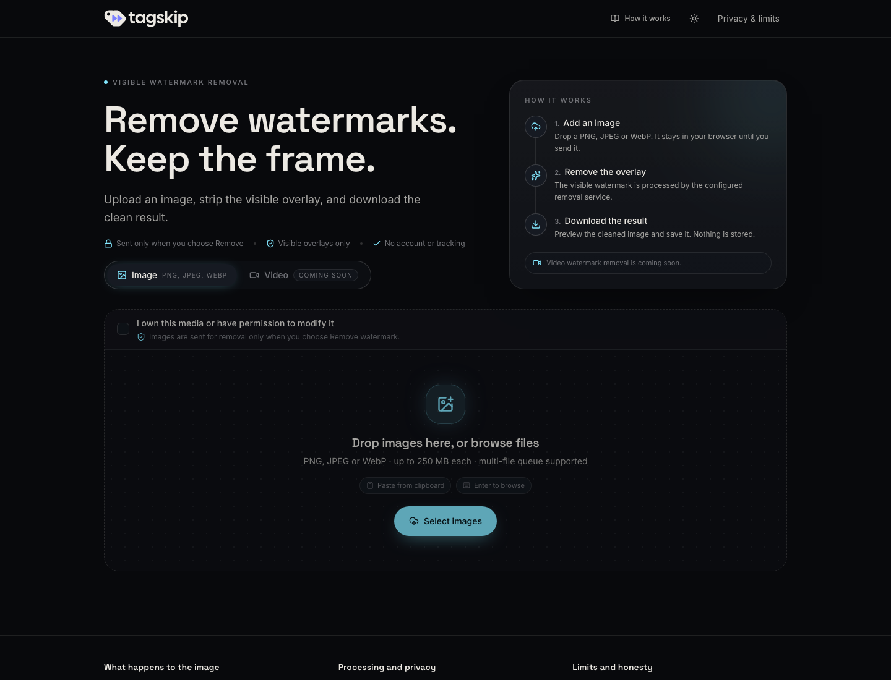

<div align="center">



# TagSkip

**Open-source Gemini watermark remover.**

Upload an image, strip the visible star overlay, download the clean result.
Runs on your own machine — no accounts, no analytics, no media storage.

[](LICENSE)
[](https://github.com/mohamed-shahal/tagskip/stargazers)
[](https://github.com/mohamed-shahal/tagskip/pulls)
[](docker-compose.yml)
[](backend/requirements.txt)
[](package.json)

[Quick start](#-quick-start) · [How it works](#-how-it-works) · [API](#-api) · [Deploy](#-deploy) · [Contributing](#-contributing)

</div>

---

## ✨ What it does

TagSkip removes the **visible Gemini star watermark** — the small, semi-transparent logo in the
bottom-right corner of generated images — and reconstructs the pixels underneath instead of
smearing a blur over them.

| Before | After |
|:---:|:---:|
|  |  |
| Visible star overlay | Restored frame |

The remover fits a smooth background surface around the mark, estimates the overlay's opacity
per pixel, and inverts the blend. Because the alpha map is smooth, real scene texture under the
logo is **kept** rather than thrown away.

> [!IMPORTANT]
> TagSkip removes **visible** marks only. It does not touch invisible provenance signals such as
> SynthID, and it is not affiliated with Google or Gemini. Use it only on media you own or have
> permission to edit.

## 🚀 Quick start

### One command (Docker)

```bash
git clone https://github.com/mohamed-shahal/tagskip.git
cd tagskip
docker compose up --build
```

Open **<http://localhost:8080>**. That's the whole stack — nginx serves the frontend and proxies
`/api` to the FastAPI container, so there is no CORS setup and no API URL to configure.

| Service | Image | Port |
| --- | --- | --- |
| `frontend` | `tagskip-web:local` (nginx) | `8080` on the host |
| `backend` | `tagskip-api:local` (FastAPI) | internal `8000` |

Stop with `docker compose down`. Rebuild after changes with `docker compose up --build`.

### Local development

Requires **Node.js 20.19+** (or 22.12+) and **Python 3.10+**.

<details>
<summary><b>Terminal 1 — API</b></summary>

```bash
python3 -m venv .venv
source .venv/bin/activate
python -m pip install -r backend/requirements.txt
npm run dev:backend
```

</details>

<details>
<summary><b>Terminal 2 — frontend</b></summary>

```bash
npm install
npm run dev
```

Open the URL Vite prints. During development Vite proxies `/api` to `http://127.0.0.1:8000`.

</details>

## 🔍 How it works

```text
Browser                          API
───────                          ───
validate + preview  ──POST──▶    decode (Pillow)
                                 locate the star (reference box + auto-locate)
                                 fit background surface (IRLS polynomial)
                                 estimate per-pixel alpha
                                 invert the blend, keep texture
                                 re-encode PNG
                    ◀──PNG───    return cleaned image
```

1. **Locate** — the mark is searched at the scaled reference position and, failing that, via a
   multi-scale top-hat detector in the bottom-right corner.
2. **Fit** — a robust polynomial surface is fitted to the clean pixels around the logo, excluding
   the logo and its JPEG ringing.
3. **Estimate** — per-pixel opacity is recovered from `a = (observed − background) / (255 − background)`,
   then cleaned into a smooth plateau with a soft anti-aliased edge.
4. **Invert** — `original = (observed − a·255) / (1 − a)`, with Wiener-style shrinkage so amplified
   noise is suppressed where there is no real texture.
5. **Polish** — opacity gain/shift refinement, matched grain, and a bounded low-frequency correction.

## 📡 API

### `POST /api/remove-watermark`

`multipart/form-data` with a single `file` field (PNG, JPEG, or WebP).

```bash
curl -X POST http://localhost:8080/api/remove-watermark \
  -F "file=@image.png" \
  --output cleaned.png
```

| Status | Meaning |
| --- | --- |
| `200` | Cleaned image, `image/png` |
| `400` | Empty upload |
| `413` | Upload exceeds `MAX_UPLOAD_BYTES` |
| `415` | Not a supported image, or not 8-bit |
| `422` | No watermark found near the expected region |

### `GET /healthz`

```json
{ "status": "ok" }
```

## ⚙️ Configuration

| Variable | Default | Service | Description |
| --- | --- | --- | --- |
| `VITE_API_BASE_URL` | same origin | Frontend build | API origin, no trailing slash. Leave unset to use the proxy. |
| `PORT` | `8000` | API | Port Uvicorn binds to. |
| `ALLOWED_ORIGINS` | `*` | API | Comma-separated CORS origins. Set this in production. |
| `MAX_UPLOAD_BYTES` | `20971520` | API | Maximum upload size (20 MiB). |

<details>
<summary><b>Pointing a production build at a separate API</b></summary>

```bash
VITE_API_BASE_URL="https://api.example.com" npm run build
```

Then set `ALLOWED_ORIGINS` on the API to your frontend origin.

</details>

## ☁️ Deploy

### Azure Container Apps

The backend ships with an idempotent deploy script that builds the image in ACR, provisions the
environment, and wires up a managed identity for registry pulls — no registry password anywhere.

```bash
az login
./backend/deploy-azure.sh
```

See [backend/DEPLOY.md](backend/DEPLOY.md) for regions, configuration, and troubleshooting.

### Anywhere else

The backend is a standard container:

```bash
docker build -f backend/Dockerfile -t tagskip-api .
docker run --rm -p 8000:8000 tagskip-api
```

## 🧱 Project structure

```text
tagskip/
├── src/                  React frontend (Vite, Tailwind, Radix UI, Zustand)
├── backend/
│   ├── main.py           FastAPI app and routes
│   ├── remover.py        Watermark removal algorithm
│   ├── Dockerfile        API image
│   ├── deploy-azure.sh   Idempotent Azure Container Apps deploy
│   └── DEPLOY.md         Deployment guide
├── e2e/                  Playwright tests and fixtures
├── Dockerfile            Frontend image (Node build → nginx)
├── nginx.conf            SPA fallback, /api proxy, security headers
└── docker-compose.yml    Full stack, one command
```

## 🛠 Tech stack

| Layer | Stack |
| --- | --- |
| Frontend | React 19, Vite 7, TypeScript 5.9, Tailwind CSS 4, Radix UI, Zustand |
| Backend | FastAPI, Uvicorn, OpenCV (headless), NumPy, Pillow |
| Testing | Vitest, Testing Library, Playwright, pytest |
| Infra | Docker Compose, nginx, Azure Container Apps |

## 🧪 Development commands

| Command | Description |
| --- | --- |
| `npm run dev` | Start the Vite dev server |
| `npm run dev:backend` | Start the FastAPI service on port 8000 |
| `npm run build` | Type-check and build the frontend into `dist/` |
| `npm run preview` | Preview the production build |
| `npm run typecheck` | TypeScript check |
| `npm run lint` | ESLint |
| `npm run test` | Frontend unit tests |
| `npm run test:backend` | Backend pytest suite |
| `npm run test:e2e` | Playwright tests (start the API first) |

## 🤝 Contributing

Issues and pull requests are welcome.

1. Fork the repo and create a branch.
2. Make your change and add or update tests where it makes sense.
3. Run `npm run lint`, `npm run typecheck`, and `npm run test` before opening a PR.
4. Describe the problem and the behavior you changed.

## 📄 License

Released under the [MIT License](LICENSE). Third-party notices are in
[THIRD_PARTY_NOTICES.md](THIRD_PARTY_NOTICES.md).

## ⚠️ Responsible use

TagSkip exists to restore images you have the right to modify — your own generations, assets you
licensed, or media you have explicit permission to edit.

- It removes **visible** overlays only. Invisible provenance marks such as SynthID are not targeted.
- Re-encoding writes a new file; embedded provenance manifests (e.g. C2PA) are not carried over.
- It cannot recover original detail where a mark is fully opaque.
- TagSkip is not affiliated with Google, Gemini, or any image-generation service.

<div align="center">
<sub>Built with FastAPI, React, and OpenCV.</sub>
</div>
